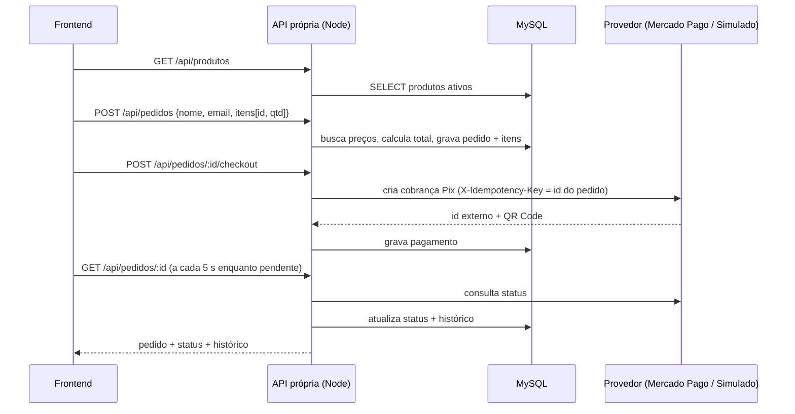
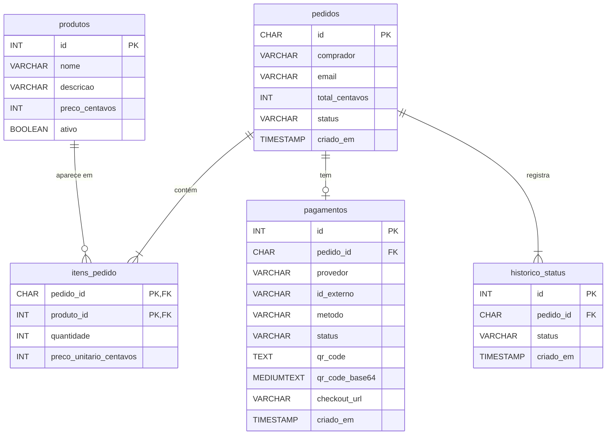

# Minha Loja — Checkout com Pix

Checkout web de uma loja fictícia: o cliente escolhe produtos, informa seus dados e paga com **Pix**.
Integração com **Mercado Pago (Checkout Transparente / Orders API)** e um modo **simulado** para demonstração sem conta.

**Stack:** Node.js + Express, MySQL, HTML/CSS/JavaScript.

## Como executar

Pré-requisitos: Node.js 20+ e MySQL.

```bash
# 1. Criar o banco e os produtos de exemplo
mysql -u root -p < database/schema.sql

# 2. Instalar dependências
npm install

# 3. Configurar variáveis de ambiente
cp .env.example .env      # depois edite o .env com a senha do MySQL

# 4. Rodar
npm start                 # http://localhost:3001
```

> **No Windows (PowerShell):** copie o `.env.example` para `.env` manualmente e crie o banco com
> `cmd /c "mysql -u root -p < database\schema.sql"` (se o `mysql` não estiver no PATH, use o caminho completo,
> ex.: `"C:\Program Files\MySQL\MySQL Server 8.0\bin\mysql.exe"`).

### Provedor de pagamento

| `PAYMENT_PROVIDER` | Comportamento |
|---|---|
| `simulado` (padrão) | Gera um Pix fictício que é aprovado automaticamente 15 s depois. Não precisa de conta. |
| `mercadopago` | Cria o Pix pelo Mercado Pago. Preencha `MP_ACCESS_TOKEN` com um Access Token do painel Mercado Pago Developers: com o **de teste**, o QR Code é fictício; com o **de produção**, o pagamento é real (a conta precisa ter uma chave Pix cadastrada). |

## Estrutura

```
database/schema.sql          # script SQL de criação + produtos de exemplo
server/
  index.js                   # servidor Express + tratamento de erros
  db.js                      # conexão MySQL
  routes/                    # endpoints REST (produtos, pedidos)
  services/pedidos.js        # regra de negócio (cálculo do total, status, idempotência)
  providers/                 # camada de integração (um módulo por provedor)
    index.js                 # escolhe o provedor pelo .env
    mercadopago.js
    simulado.js
public/
  index.html, css/style.css
  js/main.js                 # roteador (#/, #/checkout, #/pedido/:id)
  js/api.js                  # chamadas à API própria
  js/carrinho.js, utils.js
  js/pages/                  # catalogo, checkout, resultado
  js/components/             # produtoCard, resumoPedido, statusBadge
```

## Arquitetura e fluxo de pagamento



## Modelo do banco



- **produtos**: id, nome, descricao, preco_centavos, ativo
- **pedidos**: id (UUID), comprador, email, total_centavos, status, criado_em
- **itens_pedido**: pedido_id, produto_id, quantidade, preco_unitario_centavos
- **pagamentos**: pedido_id (único), provedor, id_externo, metodo, status, qr_code, qr_code_base64, checkout_url, criado_em
- **historico_status**: pedido_id, status, criado_em — uma linha a cada mudança de status do pedido

Valores em **centavos (INT)** — sem ponto flutuante para dinheiro.

## Endpoints da API

| Método | Rota | Descrição |
|---|---|---|
| GET | `/api/produtos` | Lista produtos ativos |
| POST | `/api/pedidos` | Cria pedido. Body: `{ "nome", "email", "itens": [{ "produtoId", "quantidade" }] }`. Retorna `{ id, total_centavos, status }` |
| POST | `/api/pedidos/:id/checkout` | Cria a cobrança Pix no provedor e retorna o pedido com `pagamento` (QR Code, copia e cola, link) |
| GET | `/api/pedidos/:id` | Retorna o pedido, o pagamento e o `historico` de status; se estiver pendente, consulta o provedor e atualiza o status |

Status possíveis: `pendente`, `aprovado`, `recusado`, `expirado`, `cancelado`.
Erros retornam `{ "erro": "mensagem" }` com status 400, 404, 502 ou 503.

## Decisões de projeto

- **Total calculado no backend**: o navegador envia só IDs e quantidades; os preços vêm do banco.
- **Status vem do provedor**: a tela de resultado consulta a API, que pergunta ao provedor. Nada é marcado como pago pelo navegador.
- **Sem duplicar pagamento (RF07)**: `pagamentos.pedido_id` é `UNIQUE`, o checkout devolve o pagamento existente se for chamado de novo, e o Mercado Pago recebe `X-Idempotency-Key` com o ID do pedido.
- **Camada de integração separada**: cada provedor é um módulo com `criarPix()` e `consultar()`; trocar de provedor é só mudar o `.env`.
- **Segurança**: Access Token só no backend e no `.env` (ignorado pelo Git); nenhum dado de cartão é armazenado; entradas validadas; logs sem token nem dados pessoais; HTML escapado no frontend.
- **Falhas do provedor**: timeout de 10 s, erro 429 (limite de requisições) e respostas inválidas viram mensagens claras para o usuário (502/503).

## Limitações

- Apenas **Pix**.
- **Sem webhook**: a tela do pedido consulta o status a cada 5 segundos enquanto ele está pendente (ou ao clicar em "Verificar pagamento"); a API então pergunta ao provedor.
- O carrinho fica em memória no navegador (recarregar a página o esvazia).
- O provedor **simulado** guarda os pagamentos em memória; ao reiniciar o servidor, pagamentos pendentes antigos aparecem como `expirado`.
- No ambiente de teste do Mercado Pago o Pix não é pago de verdade; o pedido fica `pendente` até expirar.

## Testes realizados

| # | Teste | Resultado |
|---|---|---|
| 1 | Fluxo completo no modo **simulado**: catálogo → checkout → QR Code → `aprovado` após ~15 s | ✅ OK |
| 2 | **Pagamento real** com credenciais de produção do Mercado Pago: QR Code gerado, pago por app de outro banco, status `aprovado` consultado na API | ✅ OK |
| 3 | **Histórico de status** registra `pendente` na criação e `aprovado` após o pagamento | ✅ OK |
| 4 | Tela do pedido **atualiza sozinha** (consulta a cada 5 s) e mostra `aprovado` sem clicar | ✅ OK |
| 5 | Formulário não avança com **campos vazios** ou **e-mail inválido** | ✅ OK |
| 6 | Botão "Ir para o pagamento" fica **desabilitado com carrinho vazio** | ✅ OK |
| 7 | API recusa pedido com nome vazio (`400 {"erro":"Nome é obrigatório"}`) | ✅ OK |
| 8 | Com o MySQL desligado, a API responde `500 {"erro":"Erro interno"}` sem expor detalhes | ✅ OK |
| 9 | Credenciais de **teste** do Mercado Pago: QR Code gerado, mas recusado pelos bancos (esperado, é um ambiente fictício) | ✅ Comportamento esperado |
